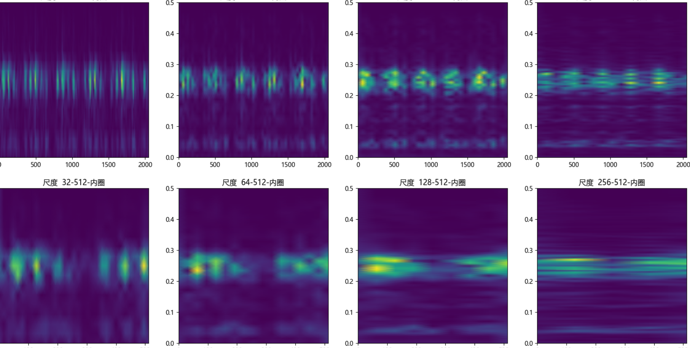
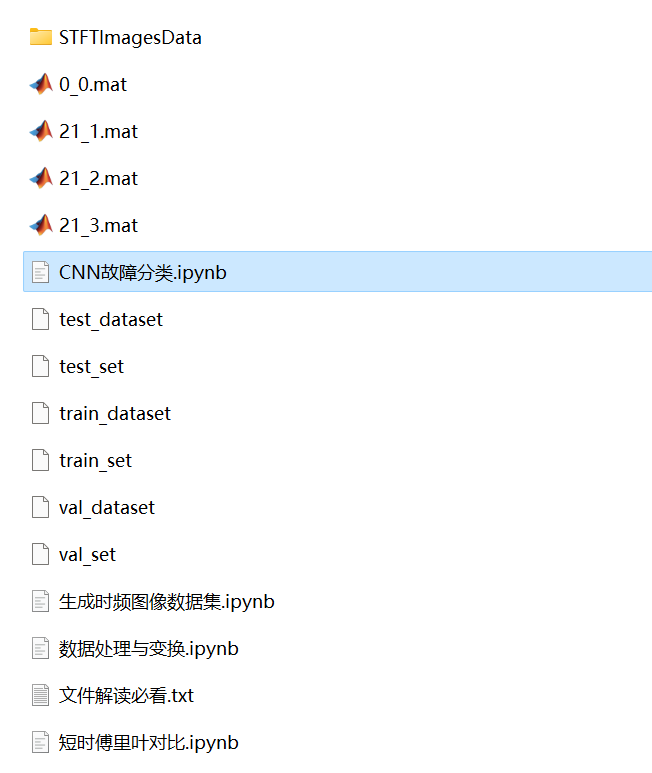
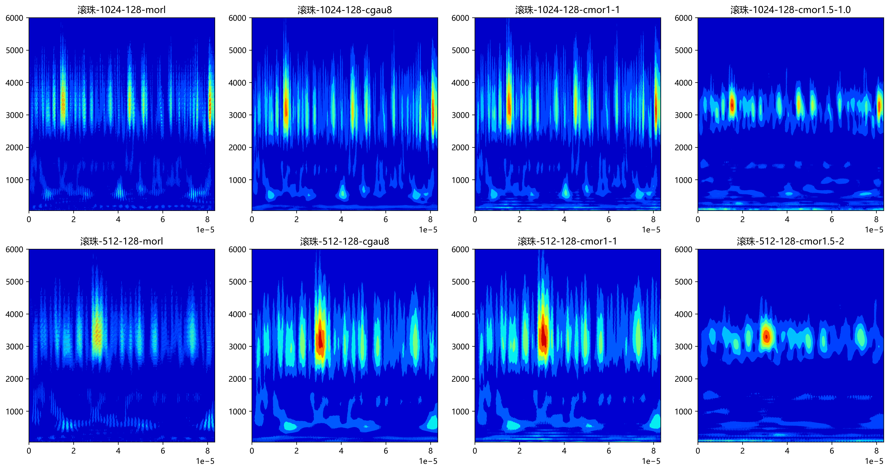

# Bearing Frequency Image, Fault Visualization

Fault Visualization
1.1 Complete CWRU bearing fault dataset
1.2 Prepared one-dimensional fault signal dataset and time-frequency image dataset, all of which can be run successfully.
Environment: Python 3.9
Python Bearing Fault Diagnosis Time-Frequency Image Processing - Short-Time Fourier Transform (STFT)
1.1 Python Bearing Fault Continuous Wavelet Transform - Code and Time-Frequency Image Classification
1.2

## Images

<!-- PAYMENT_BLOCK -->

## Get this dataset

- Payment link (Stripe): [Buy now](https://buy.stripe.com/3cs8yP7sY87d0vu9AB)
- Payment QR code: 

<!-- /PAYMENT_BLOCK -->
